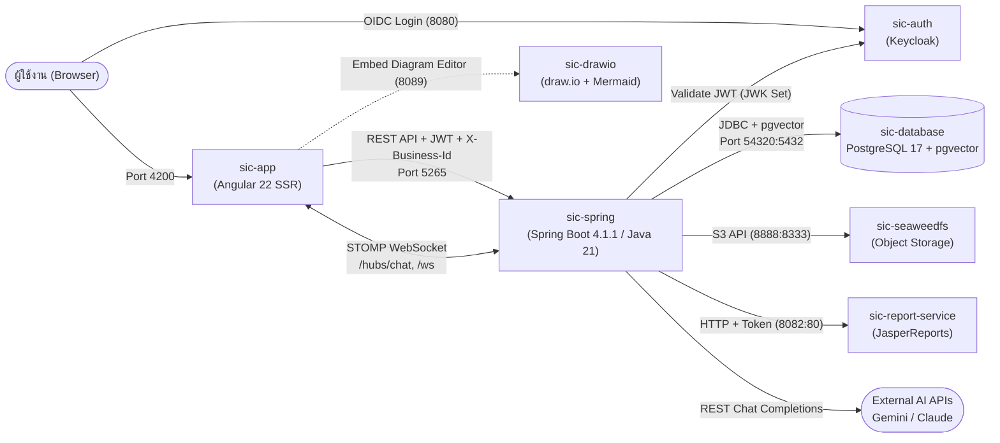

# คู่มืออธิบายโค้ดระบบ SIC (System Integration Center) สำหรับเตรียม Present Project

เอกสารนี้สรุปสถาปัตยกรรม โครงสร้างโค้ดทั้ง Frontend, Backend, Database และ Microservices จากไฟล์จริงในโปรเจกต์ เพื่อใช้ทำความเข้าใจภาพรวม ไล่ Data Flow และเตรียมตอบคำถามกรรมการ

---

## 1. ภาพรวมสถาปัตยกรรมระบบ (System Architecture)

ระบบ SIC ออกแบบเป็น **Multi-Service Architecture** ทำงานร่วมกันผ่าน Docker network ชื่อ `sic-network` (ดู [docker-compose.yml](docker-compose.yml)):

### สรุป Tech Stack ตาม Layer

| ส่วนประกอบ | เทคโนโลยีที่ใช้จริงในโค้ด | หน้าที่หลัก |
|---|---|---|
| **Frontend** | Angular 22 (`@angular/ssr`), Tailwind CSS v4, `@tanstack/angular-query-experimental`, `angular-oauth2-oidc`, `@stomp/stompjs`, Tiptap, DHTMLX Gantt, Mermaid, MaxGraph, D3 | หน้าเว็บหลัก, จัดการ SDLC, Kanban, Gantt, Rich-Text Editor, AI Wizards, Real-time Chat |
| **Backend** | Spring Boot 4.1.1, Java 21, Spring Security (OAuth2 Resource Server), Spring Data JPA, Flyway, Lombok, MapStruct, JasperReports 7.0.1, Apache POI 5.3.0, AWS SDK S3 v2.25.0 | REST APIs, Business Logic, Multi-tenant Context, RBAC, Approval Engine, AI Orchestration, WebSocket |
| **Database** | PostgreSQL 17 (`pgvector/pgvector:pg17`) + Flyway Migrations | เก็บข้อมูลระบบ (`sic_app`), ข้อมูล Auth (`sic_auth`), และ Vector Embeddings สำหรับ AI Semantic Search |
| **Auth / IAM** | Keycloak (`realm-one-project.json`, realm `sic-project`) | จัดการ Login (OIDC/OAuth2), ออก JWT Token (RS256) และจัดการ Session |
| **Object Storage** | SeaweedFS (S3-compatible) | เก็บไฟล์แนบ/รูปภาพ/เอกสารใน Buckets: `uploads`, `documents`, `public-files` |
| **Report Engine** | `sic-report-service` + JasperReports + `THSarabunNew` | สร้างรายงาน PDF/Excel จาก `.jrxml` Templates รองรับภาษาไทยและรูปภาพจาก Rich-Text (WebP) |

---

## 2. ระบบ Security, Authentication & Multi-Tenancy (จุดที่มักถูกถามบ่อย)

### 2.1 Authentication Flow (Keycloak + JWT)
1. **Frontend** (`sic-app/src/app/core/auth/auth.service.ts`) ใช้ `angular-oauth2-oidc` พาผู้ใช้ไป Login ที่ Keycloak (`sic-auth`) แล้วรับ Access Token (JWT) กลับมาผ่าน `/auth/callback`
2. ทุก Request ที่ส่งไป Backend จะแนบ `Authorization: Bearer <JWT>`
3. **Backend** (`SecurityConfig.java`) ตั้งค่าเป็น `SessionCreationPolicy.STATELESS` และตรวจสอบลายเซ็น JWT ด้วย `NimbusJwtDecoder` ผ่าน JWK Set URI ของ Keycloak (`RS256`)
4. `KeycloakGrantedAuthoritiesConverter` แปลงสิทธิ์จาก Claim `resource_access.sic-app.roles` และ `realm_access.roles` ให้เป็น Spring Security Authorities
5. Endpoint ที่เปิด Public (`permitAll`) มีเฉพาะ: `/api/auth/**`, `/api/public/**`, `/actuator/health`, `/swagger-ui/**`, `/hubs/chat/**`, `/ws/**`, `/api/storage/avatar/**`, `/api/storage/files/**`, `/api/storage/download/**`, `/api/i18n/**` ส่วนที่เหลือต้อง Authenticate ทั้งหมด

### 2.2 Multi-Tenancy: ระบบแยกข้อมูลแต่ละบริษัทอย่างไร?
ระบบรองรับหลายบริษัท/องค์กร (Business) ในฐานข้อมูลเดียว โดยใช้ **Interceptor + ThreadLocal**:
- ไฟล์หลัก: `WebConfig.java`, `BusinessContextInterceptor.java`, `BusinessContextHolder.java`
- **ลำดับการทำงานใน `BusinessContextInterceptor.preHandle()`:**
  1. อ่าน User ID จาก JWT ปัจจุบัน (`CurrentUserService`)
  2. เช็ค HTTP Header `X-Business-Id` ที่ Frontend ส่งมา → ตรวจสอบกับ `SuUserBusinessRepository.canAccessBusiness(userId, headerId)` ว่า User มีสิทธิ์ใน Business นั้นจริงหรือไม่ (ป้องกันการปลอม Header ข้าม Tenant)
  3. ถ้าไม่มี Header → ใช้ Business ที่ตั้งเป็น `isDefault = true` ของ User คนนั้น หรือ fallback เป็น Business แรกที่สังกัด
  4. เก็บ `businessId` ไว้ใน `BusinessContextHolder` (`ThreadLocal<UUID>`) ตลอดอายุ Request เพื่อให้ Service/Repository นำไปกรองข้อมูลเฉพาะองค์กรนั้น

### 2.3 Dynamic RBAC ระดับโปรแกรมและปุ่มกด
ระบบไม่ได้ Hardcode Role ไว้ใน Controller แต่ใช้ Annotation `@RequireProgram("<CODE>")` ร่วมกับ `ProgramPermissionInterceptor`:
- **`WebConfig.java`** กำหนดลำดับ Interceptor: `LanguageInterceptor` → `BusinessContextInterceptor` → `ProgramPermissionInterceptor` (ต้องอยู่หลัง `BusinessContextInterceptor` เพราะต้องใช้ `businessId` ไปเช็คสิทธิ์ในบริษัทนั้น)
- **`ProgramPermissionInterceptor.java`** แปลง HTTP Method & URI เป็น Action อัตโนมัติ:
  - URI มีคำว่า `export`, `pdf`, `print`, `download` → ตรวจสิทธิ์ **`PRINT`**
  - `GET` → ตรวจสิทธิ์ **`READ`** (ยกเว้น `CROSS_READ` เช่น `/combobox`, `/lov`, `/options` หรือ GET ตาม UUID เพื่อให้หน้าอื่นดึง Dropdown ข้ามโมดูลได้)
  - `DELETE` → ตรวจสิทธิ์ **`REMOVE`**
  - `PUT` / `PATCH` → ตรวจสิทธิ์ **`SAVE`**
  - `POST` → แยกเป็น **`ADD`** (สร้างใหม่) หรือ **`SAVE`** (แก้ไข) ผ่าน `ProgramPermissionBodyAdvice`
  - **ข้อยกเว้น (`EXEMPT`):** URL `/approve`, `/reject`, `/complete`, `/preview`, `/search` ไม่บล็อกด้วยสิทธิ์แก้ไขเอกสาร เพราะผู้อนุมัติอาจมีสิทธิ์แค่กดอนุมัติ แต่ไม่มีสิทธิ์แก้ไขเอกสาร

---

## 3. โครงสร้าง Backend (`sic-spring/sic/src/main/java/com/softinter/sicapi`)

### 3.1 การแบ่ง Package ตาม Layered Architecture
- **`config/`**: ตั้งค่า Spring (`SecurityConfig`, `WebConfig`, `WebSocketConfig`, `S3Config`, `FlywayConfig`, `JpaConfig`, `CacheConfig`, `CorsConfig`, `AuditLogAspect`, `BusinessContextHolder`)
- **`Interceptor/`**: ตัวกรอง Request (`BusinessContextInterceptor`, `ProgramPermissionInterceptor`, `LanguageInterceptor`, `JwtChannelInterceptor`)
- **`controller/`**:
  - Core & AI: `AuthController`, `AiBatchGeneratorController`, `AiModelConfigController`, `AiNavigatorController`, `AiProjectPipelineController`, `AiSqlGeneratorController`, `GlobalSearchController`
  - `basic/`: `BusinessController`, `ProfileController`, `MenuController`, `ComboboxController`, `ChatHubController`
  - `pm/`: จัดการงาน SDLC ทั้งหมด (Project, Customer, Contract, Phase, Milestone, WorkPackage, Task, Requirement, Specification, ChangeRequest, Diagram, DesignReview, TestScenario, TestCase, Bug, Delivery, Invoice, Payment, MaTicket, UserManual, DocumentVersion, TraceLink, ImpactAnalysis, Approval, Discussion, BulkDocumentExport)
  - `su/`: จัดการระบบและความปลอดภัย (`SuBusinessRoleController`, `SuProgramController`, `SuUserBusinessController`, `SuBusinessInviteController`, `AuditLogController`, `NotificationController`, `ChatController`)
  - `storage/`: `StorageController` (อัปโหลด/ดาวน์โหลดไฟล์ผ่าน SeaweedFS S3)
- **`service/impl/`**: Business Logic ทั้งหมด รวมถึง AI Generators, Export Services, Approval Engine
- **`util/`**: ตัวช่วยสำคัญ เช่น
  - `RowVersionGuard` (ป้องกันปัญหาแก้ข้อมูลทับกัน / Optimistic Locking)
  - `CodeSequenceLock` (ป้องกันเลขที่เอกสารซ้ำกันเมื่อสร้างพร้อมกัน)
  - `DocumentDiffHelper` & `JsonSnapshotHelper` (เปรียบเทียบ Version เอกสาร)
  - `ContractLifecycle` & `ContractNoHelper` (คำนวณสถานะ/เลขที่สัญญาอัตโนมัติ)
  - `PaginationUtil`, `SortValidator`, `DateRangeValidator`, `UniquenessValidator`
- **`websocket/`**: `ChatWebSocketController` รองรับ Real-time Chat & Notification ผ่าน STOMP (`/hubs/chat`, `/ws`) พร้อมตรวจ JWT ตอน Connect ด้วย `JwtChannelInterceptor`

### 3.2 Database & Migrations
- ไฟล์ SQL Migration อยู่ใน `sic-spring/sic/src/main/resources/db/migration/` (ใช้ Flyway จัดการเวอร์ชัน Schema ตั้งแต่ `V20260717...` จนถึง `V20261112...`)
- จุดเด่นสำคัญใน Migration ช่วงหลัง:
  - `V20261105180000__add_pgvector_embeddings.sql` และ `V20261106120000__add_pgvector_diagram_scenario_project.sql`: เพิ่มคอลัมน์ `vector` ในตารางเอกสารหลักๆ เพื่อทำ AI Semantic Search / RAG

---

## 4. โครงสร้าง Frontend (`sic-app/src/app`)

### 4.1 Routing & Guards (`app.routes.ts`)
- **Public Landing (`/`, `/product`, `/blog`, `/contact`)**: หน้าเว็บไซต์หลักก่อน Login
- **Auth Callback (`/auth/callback`)**: `AuthCallbackComponent` รับ Token จาก Keycloak
- **Management (`/management/...`)**: ป้องกันด้วย `authGuard` ใช้สำหรับตั้งค่า `profile` และสร้าง/เข้าร่วม/เชิญสมาชิกเข้า Business (`create`, `join`, `invite`)
- **Workspace หลัก (`/feature/...`)**: ป้องกันด้วย Guard 4 ชั้น:
  1. `authGuard` (ต้อง Login แล้ว)
  2. `profileGuard` (ต้องกรอกข้อมูล Profile พื้นฐานครบแล้ว)
  3. `businessGuard` (ต้องเลือกหรือมี Business สังกัดแล้ว)
  4. `permissionGuard` (`canActivateChild` ตรวจสิทธิ์เข้าถึงหน้านั้นๆ)
- หน้าฟอร์มแก้ไขสำคัญๆ มี `CanDeactivateGuard` คอยเตือนหากผู้ใช้กำลังจะปิดหน้าทั้งที่ยังไม่ได้กด Save

### 4.2 ตาราง Map รหัสหน้าจอทั้งหมดในระบบ

#### โมดูล Project Management (`PM` - `/feature/pm/...`)
| รหัส | Route Path | ชื่อโมดูล / หน้าที่ |
|---|---|---|
| **PMRT01** | `customer` | จัดการข้อมูลลูกค้า (Customer) |
| **PMRT02** | `project` | จัดการโครงการ (Project) |
| **PMRT04** | `contract` | จัดการสัญญาและต่ออายุสัญญา (Contract & Renew) |
| **PMRT07** | `notifications` | ศูนย์รวมการแจ้งเตือน (Notification Center) |
| **PMDT01** | `phase` | จัดการเฟสโครงการ (Phase Management) |
| **PMDT02** | `phase/:id`, `milestone`, `work-package`, `task` | โครงสร้างงาน WBS (Phase → Milestone → Work Package → Task) |
| **PMDT03** | `approval` | ศูนย์อนุมัติเอกสาร (Approval Center) |
| **PMDT04** | `requirement` | จัดการความต้องการระบบ (Requirement Management) |
| **PMDT05** | `diagram` | ออกแบบ Diagram (draw.io / Mermaid / AI SQL Export) |
| **PMDT06** | `change-request` | จัดการคำขอเปลี่ยนแปลง (Change Request & Impact Analysis) |
| **PMDT07** | `specification` | จัดทำเอกสารออกแบบระบบ (Specification Management) |
| **PMDT08** | `discussion` | กระดานสนทนา/คอมเมนต์ในโครงการ (Discussion) |
| **PMDT09** | `design-review` | ตรวจทานงานออกแบบ (Design Review / Figma integration) |
| **PMDT10** | `task-board` | กระดานติดตามงาน (Kanban Task Board) |
| **PMDT11** | `gantt`, `calendar` | แผนภูมิแกนต์ (DHTMLX Gantt) และปฏิทินงาน |
| **PMDT12** | `test-management` | ทดสอบระบบ: Test Scenario, Test Case, Test Execution, Bug Tracking |
| **PMDT14** | `delivery` | การส่งมอบงานและ Checklist (Delivery Management) |
| **PMDT15** | `manual` | คู่มือการใช้งาน (User Manual) |
| **PMDT16** | `invoice` | ใบแจ้งหนี้และการชำระเงิน (Invoice & Payment) |
| **PMDT17** | `ma-ticket` | ใบแจ้งซ่อม/บำรุงรักษาหลังส่งมอบ (MA Ticket) |
| **PMDT19** | `version` | ประวัติเวอร์ชันเอกสารและการเปรียบเทียบ (Document Version History) |
| **PMDT20** | `audit` | ประวัติการใช้งานระบบ (Audit Log) |

#### โมดูล Business & System (`BU`/`SU` - `/feature/bu/...`)
| รหัส | Route Path | ชื่อโมดูล / หน้าที่ |
|---|---|---|
| **BURT01** | `info` | ข้อมูลองค์กร/บริษัท (Business Info) |
| **BURT02** | `permission` | กำหนดสิทธิ์การใช้งานของแต่ละ Role ต่อ Program (Role & Permission) |
| **BURT03** | `role` | จัดการบทบาท (Role Management) |
| **BURT04** | `team` | จัดการทีมงานและสมาชิก (Team Management) |
| **BURT05** | `program` | จัดการเมนู/โปรแกรมในระบบ (Program Management) |
| **BURT06** | `approval-flow` | ตั้งค่าสายอนุมัติเอกสาร (Approval Flow Builder) |
| **BURT07** | - | ตั้งค่าระบบเพิ่มเติมใน BU |
| **BURP01** | - | รายงาน/บันทึกกิจกรรมในระดับ Business |

### 4.3 Shared Components & Widgets (`sic-app/src/app/core/component/`)
- **Dashboard Widgets**: `my-work-widget`, `pending-approval-widget`, `portfolio-gantt-widget`, `project-health-widget`, `sprint-health-widget`, `team-workload-widget`
- **AI UI Components**: `sic-ai-project-wizard` (สร้างทั้งโปรเจกต์จาก Prompt), `sic-ai-navigator` (ผู้ช่วยนำทาง/ตอบคำถาม Workflow), `sic-ai-batch-modal` (เจนเอกสารทีละชุด), `sic-ai-attachment-picker`
- **Core Editors & Viewers**: `sic-tiptap-editor` (Rich-text editor), `sic-ganttchart` (`dhtmlx-gantt`), `sic-kanban`, `sic-jasper-live-preview`, `sic-trace-link-panel`

---

## 5. เจาะลึก Data Flow ของ 5 ฟีเจอร์หลัก

### 5.1 ระบบ AI Ecosystem & pgvector RAG
1. **Multi-Provider AI Routing (`PmAiProviderServiceImpl`):**
   - รองรับการสลับโมเดล AI (Gemini / Claude) จากตาราง `db_ai_model_config` หรือ Environment (`AI_DEFAULT_MODEL`)
   - ใช้ `AiScopeContextService` ดึงบริบทโครงการจริงมาคุม Scope คำตอบของ AI ไม่ให้หลุดจากข้อมูลโปรเจกต์
2. **AI Project Pipeline (`AiProjectPipelineServiceImpl`):**
   - รับ Prompt ความต้องการลูกค้า → ส่งให้ AI แตกโครงสร้างเป็น JSON (`projectName`, `requirements`, `specifications`, `phases`, `tasks`, `delivery`)
   - User กด Preview ตรวจสอบก่อน → เมื่อยืนยัน (`execute`) จะบันทึกลง Database ทุกตารางแบบ `@Transactional` ในครั้งเดียว
3. **AI Navigator (`AiNavigatorServiceImpl`):**
   - แชทบอทที่มี Workflow Knowledge Base (`WORKFLOW_KB`) และ `AiModuleRegistry` สามารถแนะนำขั้นตอนการทำงานและส่ง `AiRouteSuggestionDto` ให้ Frontend พา User กระโดดไปยังหน้าจอที่ต้องการได้ทันที
4. **Auto-Vectorization ด้วย pgvector (`AiDocumentVectorService`):**
   - เมื่อมีการบันทึก/แก้ไขเอกสารใน 8 ตารางหลัก (`pm_requirement`, `pm_specification`, `pm_customer_contract`, `pm_delivery`, `pm_task`, `pm_diagram`, `pm_test_scenario`, `pm_customer_project`)
   - ระบบจะถอด HTML Tag ออก → ลงทะเบียน `TransactionSynchronization.afterCommit()` → เรียก `aiProviderService.getEmbedding()` แบบ **Asynchronous (`CompletableFuture`)** เพื่ออัปเดตคอลัมน์ `embedding` (`cast(? as vector)`)
   - **ข้อดี:** ไม่ทำให้หน้าเว็บหน่วงเวลา User กด Save และถ้าระบบ AI Embedding ภายนอกล่ม การบันทึกเอกสารหลักก็ยังไม่พัง

### 5.2 ระบบ Approval Engine & Document Versioning
- **ไฟล์หลัก:** `ApprovalServiceImpl.java`, `ApprovalFlowServiceImpl.java`, `DocumentVersionService`
- **การทำงาน:**
  1. องค์กรตั้งค่า Flow อนุมัติ (`PmApprovalFlow` + `PmApprovalFlowStep`) ตามประเภทเอกสาร (เช่น Requirement, Spec, Change Request, Delivery, Invoice, User Manual)
  2. เมื่อ User กด Submit เอกสาร → ระบบสร้าง `PmApproval` และ Step Status ตามลำดับขั้น และส่ง Notification + Email แจ้งเตือนผู้อนุมัติ
  3. ระหว่างรออนุมัติหรืออนุมัติแล้ว เอกสารจะถูกล็อกไม่ให้แก้โดยตรง (`DocumentLockedException`) หากต้องแก้ต้องสร้าง Revision/Version ใหม่ (`PmDocumentVersion`)

### 5.3 ระบบ Traceability Engine & Impact Analysis
- **ไฟล์หลัก:** `TraceLinkServiceImpl.java`, `ImpactAnalysisServiceImpl.java`
- **การทำงาน:**
  - เก็บความสัมพันธ์แบบ Graph (Source Type/ID → Target Type/ID + `TraceRelationship`) ในตาราง `pm_trace_link`
  - เช่น เชื่อม `REQUIREMENT` → `SPECIFICATION` → `DIAGRAM` → `TEST_CASE` → `BUG`
  - ใช้ Soft Delete (`isDelete = true`) เพื่อให้ตรวจสอบย้อนหลังได้
  - เมื่อมี Change Request (`PMDT06`) ระบบ `ImpactAnalysisServiceImpl` จะไล่เช็ค Trace Link เพื่อบอกได้ว่าถ้าแก้ Requirement นี้ จะกระทบ Spec, Diagram หรือ Test Case ตัวไหนบ้าง

### 5.4 ระบบ Document Export & JasperReports
- **ไฟล์หลัก:** `sic-report-service` และ `*ExportServiceImpl.java` ใน `sic-spring`
- **การทำงาน:**
  - รองรับการออกรายงานเป็น PDF (ใช้ Template `.jrxml` + Font `THSarabunNew` + `imageio-webp` สำหรับแปลงรูป WebP จาก Tiptap Editor) และ Excel (Apache POI)
  - มี `BulkDocumentExportController` สำหรับรวมเอกสารหลายโมดูลเป็นเล่ม (Project Book พร้อมสารบัญ `project_book_toc.jrxml`)

### 5.5 ระบบจัดเก็บไฟล์ (SeaweedFS S3)
- **ไฟล์หลัก:** `S3Config.java`, `FileStorageServiceImpl.java`, `StorageController.java`
- **การทำงาน:**
  - Backend คุยกับ SeaweedFS ผ่าน AWS SDK v2 (S3 Protocol)
  - แยก Bucket ตามประเภท: `uploads`, `documents`, `public-files`

---

## 6. คลังคำถาม-คำตอบ Q&A เตรียมรับมือกรรมการ

### Q1: ระบบนี้รองรับหลายบริษัท (Multi-tenant) ได้อย่างไร มีโอกาสข้อมูลรั่วข้ามบริษัทไหม?
> **แนวทางตอบ:** ใช้แนวคิด Shared Database with Tenant Isolation ครับ ทุก Request ที่เข้ามาจะผ่าน `BusinessContextInterceptor` เพื่อตรวจสอบสิทธิ์กับตาราง `su_user_business` ก่อน แล้วค่อยเก็บ `businessId` ลงใน `ThreadLocal` (`BusinessContextHolder`) แม้ฝั่ง Frontend จะส่ง Header `X-Business-Id` มา ระบบก็เช็คสิทธิ์ฝั่ง Backend ซ้ำทุกครั้งก่อนอนุญาตให้ใช้งาน จึงไม่รั่วข้ามบริษัทครับ

### Q2: การจัดการสิทธิ์ (RBAC) ทำละเอียดแค่ไหน?
> **แนวทางตอบ:** ทำละเอียดระดับ **Program + Action (Add, Save, Read, Remove, Print)** ครับ โดยใช้ Custom Annotation `@RequireProgram` คู่กับ `ProgramPermissionInterceptor` ซึ่งจะ map HTTP Method และ URL Pattern เข้ากับสิทธิ์ของ Role ในบริษัทนั้นๆ อัตโนมัติ และมีข้อยกเว้นเฉพาะทาง เช่น ผู้อนุมัติสามารถกด `/approve` ได้โดยไม่จำเป็นต้องมีสิทธิ์แก้ไขเอกสาร

### Q3: ใช้ AI เยอะขนาดนี้ ถ้าระบบ AI ภายนอกล่ม หรือช้า ระบบหลักจะค้างไหม?
> **แนวทางตอบ:** ไม่ค้างครับ อย่างระบบทำ Vector Embedding (`AiDocumentVectorService`) เราออกแบบให้ทำงานแบบ **Asynchronous (`CompletableFuture`) และรอให้ Database Transaction Commit เสร็จก่อน (`afterCommit`)** ดังนั้นต่อให้ AI API ล่มหรือช้า การกดบันทึกเอกสารของผู้ใช้จะสำเร็จทันที ไม่โดน Rollback และหน้าเว็บไม่ค้างครับ

### Q4: ถ้านำ AI มาช่วยสร้างโปรเจกต์/เอกสาร มันรู้บริบทของโปรเจกต์เราได้ยังไง?
> **แนวทางตอบ:** เราใช้ **RAG (Retrieval-Augmented Generation)** ด้วย `pgvector` บน PostgreSQL 17 ครับ ทุกครั้งที่มีการบันทึก Requirement, Spec, Task, Diagram หรือ Contract ระบบจะแปลงเนื้อหาเป็น Vector เก็บไว้ในคอลัมน์ `embedding` และมี `AiScopeContextService` ดึงบริบทโครงการส่งให้ AI ตอน Generate ทำให้คำตอบตรงกับโปรเจกต์จริง ไม่หลุด Scope ครับ

### Q5: ถ้าผู้ใช้ 2 คนเปิดแก้เอกสารเดียวกันพร้อมกัน หรือกดสร้างเอกสารพร้อมกัน เลขเอกสารจะซ้ำหรือข้อมูลทับกันไหม?
> **แนวทางตอบ:** มีตัวป้องกันทั้ง 2 กรณีครับ:
> 1. **กันข้อมูลทับกัน:** ใช้ `RowVersionGuard` (Optimistic Locking) เช็คเวอร์ชันของ Record ก่อนบันทึก
> 2. **กันเลขที่เอกสารซ้ำ:** ใช้ `CodeSequenceLock` คุมจังหวะการออก Running Code ไม่ให้ชนกันครับ

### Q6: ทำไมถึงแยก `sic-report-service` กับ `sic-auth` (Keycloak) ออกมาจาก Backend หลัก?
> **แนวทางตอบ:** เพื่อ **Separation of Concerns** ครับ:
> - **Keycloak** จัดการเรื่อง Identity, Password, OIDC Token ที่มีมาตรฐานความปลอดภัยสูงอยู่แล้ว ไม่ต้องเขียน Auth เองใหม่ทั้งหมด
> - **Report Service** แยกงาน Render JasperReports ที่กิน CPU/Memory สูงออกจาก API หลัก ทำให้ API หลักยังคงตอบสนองหน้าเว็บได้เร็วครับ

---

## 7. เช็กลิสต์ซ้อม Demo ก่อนขึ้นพูด
1. **Login Flow:** เข้าผ่าน Keycloak → เลือก Business Context
2. **AI Highlight:** โชว์ `AI Project Wizard` สร้าง Project → Requirement → Spec → Task อัตโนมัติในคลิกเดียว
3. **Traceability & Approval:** โชว์การเชื่อม Trace Link (Requirement ↔ Spec ↔ Test Case) และการส่งอนุมัติใน `Approval Center`
4. **Execution & Visuals:** โชว์ `Task Board (Kanban)` / `Gantt Chart` / `Diagram Editor`
5. **Output & Audit:** โชว์การ Export รายงาน PDF ภาษาไทย และหน้า `Audit Log` ตรวจสอบย้อนหลัง

